# Diagrama de classes

O diagrama acompanha as classes Java da ScentWare na Tarefa 4. Os atributos e as operações principais aparecem abaixo; os getters e setters repetitivos ficam no Javadoc. `+` indica acesso público, `-` privado e `#` protegido. As multiplicidades representam as referências e coleções do gerenciador; as listas começam vazias, exceto pelos modelos recebidos na construção.

```mermaid
classDiagram
    direction LR

    class Main {
        +main(String[] args) void
    }
    class GerenciadorProducao {
        -ArrayList~Demanda~ demandas
        -ArrayList~Produto~ produtosFabricados
        -ArrayList~Maquina~ maquinas
        -ArrayList~Produto~ produtosModelos
        -MateriaPrima materiaPrima
        -double budget
        -EstrategiaProducao estrategiaAtual
        -double riscoInicialProduto
        -int proximoLote
        +setEstrategia(EstrategiaProducao novaEstrategia) void
        +registrarDemanda(Demanda demanda) void
        +adicionarMaquina(Maquina maquina) void
        +buscarDemandaPendente(TipoProduto tipoProduto) Demanda
        +atualizarDemanda(TipoProduto tipoProduto, int quantidade) boolean
        +comprarMateriaPrima(double quantidade) boolean
        +executarProximaProducao() void
        +fabricarDemanda(Demanda demanda, Produto produtoModelo) boolean
        +getCustoProducao(int quantidadeProdutos) double
        -buscarProdutoModelo(TipoProduto tipoProduto) Produto
        -calcularCustoProducao(int quantidadeProdutos) double
        -criarProduto(Produto produtoModelo, int numeroProduto) Produto
        +gerarAuditoriaGeral() void
        +detalharProdutos() void
        +detalharMaquinas() void
        +exibirArmazem() void
        +exibirDemandas() void
        +exibirBudget() void
        +exibirEstrategiaAtual() void
    }
    class Demanda {
        -TipoProduto tipoProduto
        -int quantidadeProdutos
        -StatusDemanda status
        -double custoTotal
        +atualizarQuantidade(int novaQuantidade) boolean
        +calcularMateriaPrimaNecessaria(Produto produto) double
        +viabilidadeFinanceira(double budget) boolean
        +iniciarProducao() boolean
        +voltarParaPendente() void
        +concluir() void
        +cancelar() void
    }
    class MateriaPrima {
        -String id
        -String nome
        -double quantidade
        -String unidade
        -double custoPorUnidade
        +consumir(double quantidade) boolean
        +adicionarEstoque(double quantidade) void
        +verificarDisponibilidade(double quantidade) boolean
    }
    class Produto {
        <<abstract>>
        -String id
        -String nome
        -String status
        -double quantidadeMateriaPrimaPorUnidade
        -double qualidade
        -double probabilidadeFalhaAcumulada
        -int lote
        -int totalProdutosFabricados$
        +processar() void*
        +calcularTempoProducao() double*
        +getTipo() TipoProduto*
        +gerarRelatorioDiagnostico() String
        +precisaManutencao() boolean
        +aumentarProbabilidadeFalha(double aumento) void
        #incrementarTotalProdutosFabricados() void$
        +getTotalProdutosFabricados() int$
    }
    class ProdutoHidratante {
        +processar() void
        +calcularTempoProducao() double
        +getTipo() TipoProduto
    }
    class ProdutoCremeDeMaos {
        +processar() void
        +calcularTempoProducao() double
        +getTipo() TipoProduto
    }
    class ProdutoEsfoliante {
        +processar() void
        +calcularTempoProducao() double
        +getTipo() TipoProduto
    }
    class Maquina {
        <<abstract>>
        -String nome
        -boolean ligada
        -double capacidadeMaxima
        -double probabilidadeFalha
        -double custoOperacao
        -double health
        -double maximoDesgaste
        -int falhas
        -Random random
        +processar(Produto produto) boolean*
        +getTipo() String*
        +gerarRelatorioDiagnostico() String
        +precisaManutencao() boolean
        +quebrada() boolean
        +contabilizarFalha() void
        +reparar() void
        +ligar() void
        +desligar() void
        #verificarFalha() boolean
        #desgasteAleatorio() void
    }
    class MaquinaHomogeneizador {
        +processar(Produto produto) boolean
        +getTipo() String
    }
    class MaquinaEmpacotadora {
        +processar(Produto produto) boolean
        +getTipo() String
    }
    class MaquinaInspecao {
        -Random random
        +processar(Produto produto) boolean
        +getTipo() String
    }
    class Auditavel {
        <<interface>>
        +gerarRelatorioDiagnostico() String
        +precisaManutencao() boolean
    }
    class EstrategiaProducao {
        <<interface>>
        +selecionarDemanda(List~Demanda~ demandas, double orcamentoDisponivel) Demanda
        +getNomeEstrategia() String
    }
    class EstrategiaOrdemChegada {
        +selecionarDemanda(List~Demanda~ demandas, double orcamentoDisponivel) Demanda
        +getNomeEstrategia() String
    }
    class EstrategiaMaiorDemanda {
        +selecionarDemanda(List~Demanda~ demandas, double orcamentoDisponivel) Demanda
        +getNomeEstrategia() String
    }
    class EstrategiaMaximoProdutos {
        +selecionarDemanda(List~Demanda~ demandas, double orcamentoDisponivel) Demanda
        +getNomeEstrategia() String
    }
    class TipoProduto {
        <<enumeration>>
        CREME_DE_MAOS
        ESFOLIANTE
        HIDRATANTE
        -String nome
        +getNome() String
    }
    class StatusDemanda {
        <<enumeration>>
        PENDENTE
        EM_PRODUCAO
        CONCLUIDA
        CANCELADA
        -String descricao
        +getDescricao() String
    }
    class Cenario {
        <<enumeration>>
        IDEAL
        APOCALIPTICO
        -String nome
        -double budget
        -double riscoInicialProduto
        -double probabilidadeFalhaHomogeneizador
        -double probabilidadeFalhaEmpacotador
        -double probabilidadeFalhaInspecao
        -double maximoDesgasteHomogeneizador
        -double maximoDesgasteEmpacotador
        -double maximoDesgasteInspecao
        +exibirCenarioAtual() void
    }
    class RuntimeException {
        <<Java>>
    }
    class PlantaException
    class RecursoInsuficienteException
    class DemandaInvalidaException

    Main ..> Cenario : escolhe configuracao
    Main ..> GerenciadorProducao : monta e chama pelo menu
    Main ..> EstrategiaProducao : oferece as tres regras
    Main ..> PlantaException : trata erro de dominio
    GerenciadorProducao "1" o-- "0..*" Demanda : demandas
    GerenciadorProducao "1" o-- "0..*" Produto : produtosModelos / produtosFabricados
    GerenciadorProducao "1" o-- "0..*" Maquina : maquinas em ordem
    GerenciadorProducao "1" --> "1" MateriaPrima : estoque
    GerenciadorProducao "1" --> "1" EstrategiaProducao : estrategiaAtual
    Demanda "0..*" --> "1" TipoProduto : tipoProduto
    Demanda "0..*" --> "1" StatusDemanda : status
    Demanda ..> Produto : calcula consumo pelo modelo
    Produto ..> TipoProduto : getTipo
    Maquina ..> Produto : processa
    Auditavel <|.. Produto
    Auditavel <|.. Maquina
    Produto <|-- ProdutoHidratante
    Produto <|-- ProdutoCremeDeMaos
    Produto <|-- ProdutoEsfoliante
    Maquina <|-- MaquinaHomogeneizador
    Maquina <|-- MaquinaEmpacotadora
    Maquina <|-- MaquinaInspecao
    EstrategiaProducao <|.. EstrategiaOrdemChegada
    EstrategiaProducao <|.. EstrategiaMaiorDemanda
    EstrategiaProducao <|.. EstrategiaMaximoProdutos
    EstrategiaProducao ..> Demanda : seleciona sem alterar
    RuntimeException <|-- PlantaException
    PlantaException <|-- RecursoInsuficienteException
    PlantaException <|-- DemandaInvalidaException
    GerenciadorProducao ..> RecursoInsuficienteException : recurso insuficiente
    GerenciadorProducao ..> DemandaInvalidaException : demanda invalida
    Demanda ..> DemandaInvalidaException : transicao invalida
    MateriaPrima ..> RecursoInsuficienteException : estoque insuficiente
```

O **Strategy** já existe na base: `GerenciadorProducao` é o contexto, `EstrategiaProducao` é o contrato e as três classes concretas são as regras intercambiáveis. Ordem de chegada pega a primeira demanda pendente com itens; maior demanda pega a maior quantidade pendente; máximo de produtos compara somente as que cabem no budget. Empates mantêm a primeira da lista. A conferência final de estoque e orçamento fica no gerenciador.

`Auditavel` permite usar produtos e máquinas no mesmo relatório. A hierarquia de exceções separa falta de recurso de demanda inválida; as três exceções são de domínio e chegam ao tratamento no menu. Rejeição aleatória de produto é resultado da simulação.

As duas coleções de `Produto` têm papéis diferentes: `produtosModelos` guarda referências usadas na criação e `produtosFabricados` guarda as unidades aprovadas. Elas não representam subclasses diferentes. `Cenario` fornece valores na inicialização; o gerenciador não guarda uma referência ao enum.
