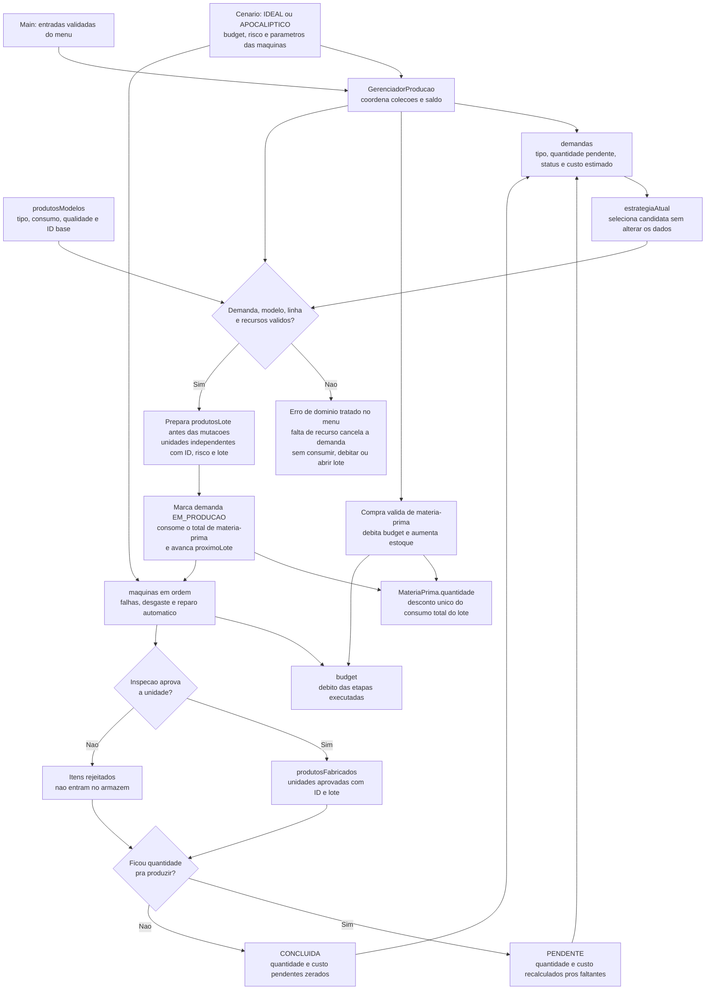

# Diagrama de dados

Este é o modelo conceitual dos objetos **em memória** da ScentWare. O programa não usa banco de dados nem salva uma sessão pra recuperar depois. Os blocos abaixo representam objetos, coleções e referências Java; não são tabelas SQL e não adicionam identificadores ao código.

```mermaid
erDiagram
    GerenciadorProducao ||--o{ Demanda : "demandas, ArrayList"
    GerenciadorProducao ||--o{ Produto : "produtosModelos, ArrayList"
    GerenciadorProducao ||--o{ Produto : "produtosFabricados aprovados, ArrayList"
    GerenciadorProducao ||--o{ Maquina : "maquinas em ordem, ArrayList"
    GerenciadorProducao }o--|| MateriaPrima : "materiaPrima"
    GerenciadorProducao }o--|| EstrategiaProducao : "estrategiaAtual"
    Demanda }o--|| TipoProduto : "tipoProduto"
    Demanda }o--|| StatusDemanda : "status"

    GerenciadorProducao {
        double budget "Saldo atual em reais"
        double riscoInicialProduto "Risco aplicado a cada unidade nova"
        int proximoLote "Comeca em 1; avanca ao iniciar lote valido"
    }
    MateriaPrima {
        String id "Identificador da materia-prima, ex MP001"
        String nome "Ex Oleo de Amendoas"
        double quantidade "Saldo do estoque na unidade informada"
        String unidade "Ex mL"
        double custoPorUnidade "Preco de compra em reais por unidade"
    }
    Demanda {
        TipoProduto tipoProduto "Enum do cosmetico solicitado"
        int quantidadeProdutos "Quantidade ainda pendente, aceita zero"
        StatusDemanda status "Estado atual da demanda"
        double custoTotal "Custo estimado para a quantidade pendente"
    }
    Produto {
        String id "ID do modelo ou ID da unidade criada"
        String nome "Nome do cosmetico"
        String status "Aguardando, Em processamento, Aprovado ou Rejeitado"
        double quantidadeMateriaPrimaPorUnidade "Consumo de uma unidade na linha"
        double qualidade "Qualidade do tipo entre zero e um"
        double probabilidadeFalhaAcumulada "Risco acumulado entre zero e um"
        int lote "Zero no modelo; numero do lote na unidade criada"
        int totalProdutosFabricados "Campo static compartilhado; inclui rejeitados"
    }
    Maquina {
        String nome "Nome da etapa da linha"
        boolean ligada "Estado de funcionamento"
        double capacidadeMaxima "Capacidade configurada na montagem"
        double probabilidadeFalha "Chance basica entre zero e um"
        double custoOperacao "Debito em reais por unidade processada"
        double health "Saude entre zero e cem"
        double maximoDesgaste "Limite de desgaste em pontos de saude"
        int falhas "Numero de falhas contabilizadas"
        Random random "Gerador de sorteios da maquina"
    }
    EstrategiaProducao {
        String implementacao "OrdemChegada, MaiorDemanda ou MaximoProdutos"
    }
    TipoProduto {
        String nome "Nome de exibicao do enum"
    }
    StatusDemanda {
        String descricao "Descricao de exibicao do enum"
    }
```

`implementacao` indica o tipo concreto da referência `estrategiaAtual`, não um novo atributo Java. As estratégias não guardam estado. Os enums são valores compartilhados: `TipoProduto` possui `CREME_DE_MAOS`, `ESFOLIANTE` e `HIDRATANTE`; `StatusDemanda` possui `PENDENTE`, `EM_PRODUCAO`, `CONCLUIDA` e `CANCELADA`. O tipo de um produto é retornado por `getTipo()`, implementado na subclasse; ele não é um campo armazenado em `Produto`.

A demanda não tem ID próprio nem referência direta a uma unidade fabricada. O gerenciador encontra o modelo pelo `TipoProduto`. Cada tentativa de lote válida recebe um inteiro `lote`; esse número fica nas unidades criadas. A unidade recebe um ID formado pelo ID do modelo e pelo contador de produtos. Os rejeitados contam como fabricados e consomem recursos, mas não entram em `produtosFabricados`.

`quantidade` em `MateriaPrima` é o estoque de insumo; o estoque de cosméticos acabados é a coleção `produtosFabricados`. Antes de alterar o estado da fábrica, o gerenciador valida a operação e prepara as unidades independentes na lista local `produtosLote`. Depois, inicia a demanda e desconta de uma vez toda a matéria-prima do lote, evitando arredondamentos acumulados de vários descontos pequenos.

`budget` é o saldo disponível: compra debita quantidade vezes custo do insumo, e produção debita a operação de cada máquina efetivamente usada. O custo da demanda é uma estimativa da passagem pela linha, sem cobrar de novo a compra do insumo.

O fluxo abaixo mostra de onde vêm os dados e quando mudam:

O bloco final representa o fechamento depois que todas as unidades do lote foram tentadas. As consultas do menu e a auditoria leem o estado dessas mesmas referências. O cenário só fornece a configuração inicial; o saldo, o estoque e a saúde das máquinas mudam durante a sessão.
